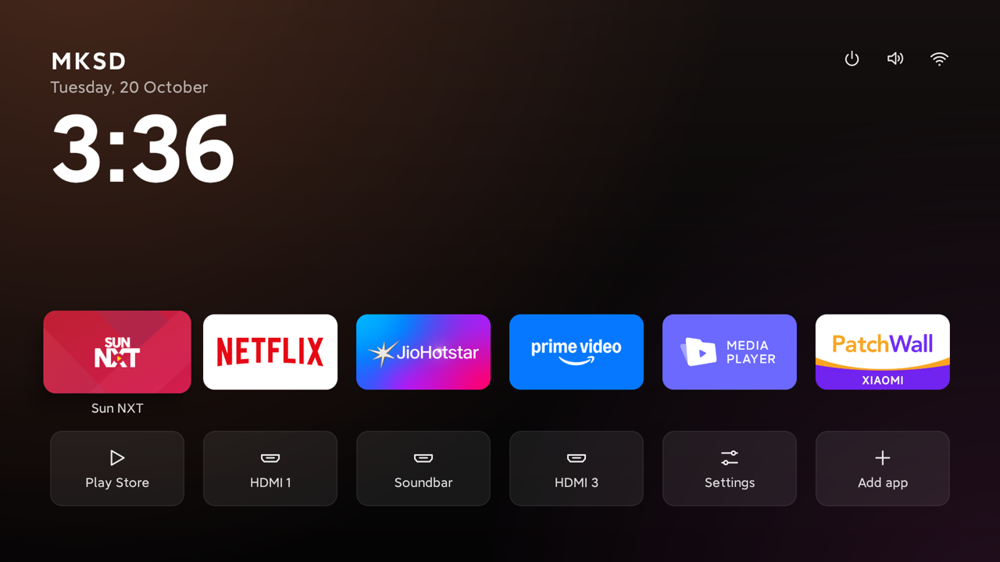
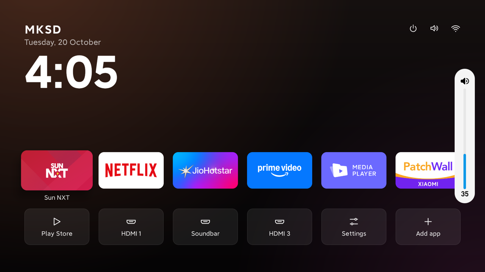

# Xiaomi / Redmi TVs: what worked, and what to keep

Tested on a **Redmi / Xiaomi Mi TV**: Android TV 10 (API 29) with the newer Google
"Home / Shop / Discover / Apps" home screen, a MediaTek chip and **1.8 GB of RAM**. Sound goes to a
soundbar over HDMI eARC. Day-to-day settings for this TV are in [mksd_setting.md](../mksd_setting.md).

## Before and after



Before, the stock Google home screen had a "Sponsored" banner across the top, a "Sponsored by JioHotstar" row, plus
Top-selling, Popular and Trending rows. After: the clock, the MKSD title, a fixed app row and the HDMI inputs. Top
right: ⏻ Detox, 🔊 volume box, Wi-Fi.

| Soundbar on eARC: the MKSD volume box | TV speakers: the TV's own bar, box hidden |
| --- | --- |
|  |  |

## Things that are different on this TV

**The Google home screen always wins.** With `com.google.android.tvlauncher` on, pressing Home opens it, even when
this home screen holds the HOME role and is set with `cmd package set-home-activity`. So "pick your home in
Settings → Default home app" doesn't work here. It has to be turned off: `install.sh` does that, and the
⏻ Detox switch turns it back on and off from the remote.

**PatchWall is an app, not a home screen.** `com.mitv.tvhome.atv` (Xiaomi PatchWall) has a normal app tile and
isn't on `install.sh`'s list of home screens, so it stays installed and works as a tile on the app row.
`com.duokan.factorytest` also answers Home (the factory menu). `install.sh` leaves it on, which is correct.

**Turning off Ambient Mode sends the TV to standby after 5 minutes.** The screensaver is
`com.google.android.backdrop/.Backdrop` and the screen-off timeout is 5 minutes. With `backdrop` off, the screensaver
can't start, and the TV goes to standby instead. Switch the screensaver to Android's plain one when you turn
`backdrop` off:

```sh
adb shell settings put secure screensaver_components com.android.dreams.basic/.Colors
```

**Three Android apps turn themselves back on at boot.** `com.android.dreams.basic`, `com.android.htmlviewer` and
`com.android.printspooler` said `disabled-user`, but were on again after a restart. They're tiny, so leave them on.

**eARC is "Auto / Off", not "On".** Auto is the "on" setting: the TV uses eARC when the handshake works and ARC when
it doesn't. After standby this pair sometimes comes back on plain ARC (the CEC log shows `Initiate ARC` from the
soundbar). That happens with every app on too, so it isn't caused by any cleanup. Try a certified Ultra High Speed
(HDMI 2.1) cable and the latest soundbar firmware.

**No volume bar with an eARC soundbar.** In eARC mode the TV hides its own volume bar. The soundbar still reports its
level over HDMI-CEC (`<Report Audio Status>`, 0–100), and Android keeps it as the music volume (max 100 on this TV), so
an app can show the exact level. That's the MKSD volume box. On ARC and TV speakers, the TV shows its own bar.

**Android 10: network permission added in an update doesn't work until a fresh install.** An app that gains
`INTERNET` in an update gets `socket failed: EPERM`, even though `dumpsys package` says it's granted. Uninstall and
install again to fix it.

**Fonts.** Xiaomi ships MiLan Pro (`/system/fonts/MILanPro_*.ttf`) without registering it by name. The home screen
loads it from the file.

## Memory, measured

With nothing open, about half of the 1.8 GB was in use. The biggest users:

| App | Memory (PSS) | Notes |
| --- | --- | --- |
| `com.google.android.tvlauncher` (Google home) | ~200 MB | off with this home screen |
| `com.google.android.gms` | ~100 MB | keep |
| `com.miui.tv.analytics` | ~93 MB | Xiaomi usage tracking: see below |
| `com.google.android.katniss` | ~60 MB | voice search: keep if you use the mic |
| `com.xiaomi.mitv.updateservice` | ~41 MB | system updates: keep |
| `com.mitv.tvhome.atv` (PatchWall) | ~32 MB | |
| `com.google.android.tvrecommendations` | ~15 MB | sponsored row: off |

## Safe to turn off

All of these were turned off, the TV was restarted, and it worked: home, remote, inputs, playback and casting.

| App | Package |
| --- | --- |
| Google TV sponsored row | `com.google.android.tvrecommendations` |
| Ambient Mode (ads screensaver) | `com.google.android.backdrop`, but change the screensaver first (above) |
| Play Movies, YouTube Music, Play Games | `com.google.android.videos`, `com.google.android.youtube.tvmusic`, `com.google.android.play.games` |
| Google feedback | `com.google.android.feedback` |

Probably fine, but not yet tested through a restart on this TV:

| App | Package |
| --- | --- |
| Xiaomi usage tracking (~93 MB) | `com.miui.tv.analytics` |
| Xiaomi statistics upload | `com.xiaomi.statistic` |
| Built-in manual | `com.xiaomi.mitv.handbook` |
| Google bug report sender | `com.google.android.tv.bugreportsender` |
| Mi Music, Gallery (if unused) | `com.xiaomi.mimusic2`, `com.mitv.gallery` |

## Keep these on

- `com.mediatek.wwtv.tvcenter`: Live TV and the HDMI inputs.
- `com.mediatek.wwtv.setupwizard`, `com.mediatek.tvinput`, and all `com.mediatek.*` apps.
- `com.mitv.tvhome.atv`, `com.mitv.tvhome.michannel`, `com.xiaomi.mitv.res`: PatchWall and its parts.
- `com.xiaomi.mitv.updateservice`: system updates.
- `com.xiaomi.wfdsinkhelperservice`, `com.mitv.milinkservice`, `com.xiaomi.mitv.smartshare`: screen mirroring and sharing.
- `com.mitv.tvlock`: the parental lock.
- `com.xiaomi.mitv.tvmanager`, `com.mitv.videoplayer`, `com.xiaomi.mitv.mediaexplorer` (USB playback).
- `com.duokan.factorytest`, `mediatek.factorymenu.ui`: factory menus.
- Everything `candidates.sh` marks `never`. Many Xiaomi system apps (`mitv.service`, `com.mediatek.tv.agent`,
  `com.xiaomi.android.tvsetup.partnercustomizer` and others) are `PERSISTENT`, so they wouldn't stay off anyway.

`candidates.sh` doesn't know most Xiaomi packages yet, so on this TV about 70 apps show as `review`. Use the lists
above instead.
